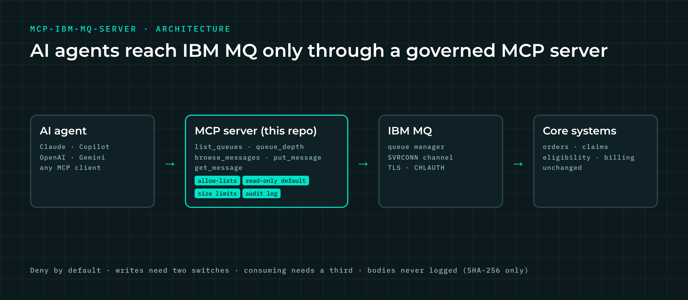

# mcp-ibm-mq-server

**A governed [Model Context Protocol](https://modelcontextprotocol.io) (MCP) server that lets AI agents read and send IBM MQ messages without bypassing enterprise controls.**



Most AI agent demos connect straight to core systems with a service account. That never gets past security in a bank, a hospital or a government agency. This server puts a narrow, audited tool layer between the agent and IBM MQ, so Claude, Copilot, OpenAI or Gemini agents can work with existing queues while the queue manager, its channels and the core systems stay unchanged.

It is the reference implementation for issue #1 of my newsletter, [*Integration to Intelligence*](https://www.linkedin.com/in/aashish-malaviya): *"Your AI agent shouldn't touch your core systems directly."*

## Why this design

| Principle | How it is enforced |
| --- | --- |
| **Tools, not tables** | Agents get five business-level tools, never raw MQI access |
| **Deny by default** | Only queues on an allow-list are visible; everything else is refused |
| **Read-only by default** | Writes need `MQ_READ_ONLY=false` **and** the queue on the write list |
| **Consuming is a separate decision** | Destructive `get_message` needs a third switch, `MQ_ALLOW_DESTRUCTIVE_GET=true` |
| **Bounded** | Message size limit and a cap on how many messages one browse returns |
| **Auditable** | Every call, allowed or denied, is a JSON audit line; bodies are never logged, only their SHA-256 |
| **Model-agnostic** | Any MCP client: Claude Desktop, Claude Code, Copilot Studio, OpenAI Agents SDK, Gemini |

## Tools

| Tool | What it does | MCP annotation |
| --- | --- | --- |
| `list_queues` | Queues this agent may read or write | read-only |
| `queue_depth` | Current depth of an allowed queue | read-only |
| `browse_messages` | Read up to N messages **without** removing them | read-only |
| `put_message` | Send a text message (optional correlation ID) | write |
| `get_message` | Consume the next message | destructive |

## Quick start (no IBM MQ needed)

```bash
pip install -e ".[dev]"
MQ_FAKE=true MQ_READ_QUEUES=ORDERS.STATUS mcp-ibm-mq-server
```

`MQ_FAKE=true` uses an in-memory queue manager seeded with a sample message, so you can try the tools from any MCP client in a minute.

## Run against a real IBM MQ

1. Start IBM's free developer queue manager (creates `QM1`, `DEV.APP.SVRCONN` and `DEV.QUEUE.1`):

   ```bash
   cp .env.example .env        # set MQ_PASSWORD
   docker compose up -d
   ```

2. Install the IBM MQ client libraries ([IBM MQ redistributable client](https://www.ibm.com/support/pages/downloading-ibm-mq-redistributable-clients)) and the `mq` extra:

   ```bash
   pip install -e ".[mq]"
   ```

3. Point the server at the queue manager and choose what the agent may do:

   ```bash
   export MQ_QMGR=QM1 MQ_CONN_INFO="localhost(1414)" MQ_CHANNEL=DEV.APP.SVRCONN
   export MQ_USER=app MQ_PASSWORD=...           # from .env, never committed
   export MQ_READ_QUEUES=DEV.QUEUE.1
   mcp-ibm-mq-server
   ```

## Connect it to Claude Desktop

Add to `claude_desktop_config.json` (see [`examples/claude_desktop_config.json`](examples/claude_desktop_config.json)):

```json
{
  "mcpServers": {
    "ibm-mq": {
      "command": "mcp-ibm-mq-server",
      "env": {
        "MQ_FAKE": "true",
        "MQ_READ_QUEUES": "ORDERS.STATUS",
        "MQ_AGENT_ID": "claude-desktop"
      }
    }
  }
}
```

Then ask: *"What's on the ORDERS.STATUS queue?"*

## Configuration

| Variable | Default | Purpose |
| --- | --- | --- |
| `MQ_READ_QUEUES` | *(none)* | Comma-separated queues the agent may browse and inspect |
| `MQ_WRITE_QUEUES` | *(none)* | Queues the agent may put to |
| `MQ_READ_ONLY` | `true` | Master switch for all writes |
| `MQ_ALLOW_DESTRUCTIVE_GET` | `false` | Allow `get_message` to consume |
| `MQ_MAX_MESSAGE_BYTES` | `65536` | Largest message an agent may send |
| `MQ_MAX_BROWSE` | `20` | Most messages one browse returns |
| `MQ_AUDIT_LOG` | stderr | Path for JSON-lines audit log |
| `MQ_AGENT_ID` | `unknown-agent` | Identity recorded in the audit log |
| `MQ_QMGR`, `MQ_CONN_INFO`, `MQ_CHANNEL`, `MQ_USER`, `MQ_PASSWORD` | | Queue manager connection |
| `MQ_FAKE` | `false` | Use the in-memory demo queue manager |

## Production notes

- Run the server behind your **API gateway** (Apigee, Azure API Management, Kong, IBM API Connect) when exposing it over HTTP, so agents inherit OAuth identity, rate limits and logging. Use stdio for local clients.
- Give the MQ user **least privilege** with `setmqaut` (browse/inq on read queues, put on write queues only) and enable **TLS** and **CHLAUTH** on the channel. The policy here is a second line of defence, not a replacement for MQ security.
- Ship the audit log to your SIEM; correlate on `audit_id`, `msg_id` and `MQ_AGENT_ID`.
- Keep a **human-in-the-loop** step for high-risk puts (payments, account changes) in the agent workflow.

## Tests

```bash
pip install -e ".[dev]" && pytest
```

Tests use the in-memory client, so they run anywhere, including CI.

## Roadmap

- Streamable HTTP transport with OAuth (MCP authorization spec)
- JSON-schema validation of message bodies per queue
- Approval hook for writes above a risk threshold
- IBM MQ REST API client option (no native client libraries)

## About

Built by **Aashish Malaviya**, Principal Architect at [Arch SI](https://archsi.io) (Architecture · System Intelligence). 20+ years of enterprise integration on IBM MQ, ACE and DataPower across banking, security services and government, now connecting AI agents to the systems they act on.

[LinkedIn](https://www.linkedin.com/in/aashish-malaviya) · [archsi.io](https://archsi.io)

## License

MIT
